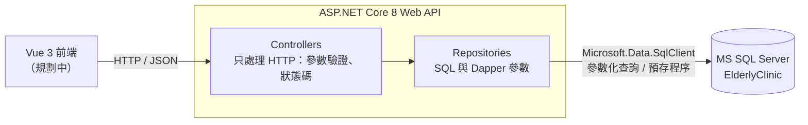

# 樂齡門診掛號與健康追蹤系統

以長者門診為情境的練習專案：MS SQL Server 資料庫，加上 ASP.NET Core 8 Web API（Dapper）。
資料全部是假資料，不含任何真實個資。

## 功能

### 資料庫（`database/`）

- 5 張資料表：Departments 科別、Doctors 醫師、Patients 病人、Appointments 掛號、VitalSigns 生命徵象
- 約束：主鍵、外鍵、UNIQUE、CHECK（性別、診別、掛號狀態、生命徵象合理範圍）
- 篩選唯一索引：同一病人在同一醫師同一診只能有一筆有效掛號（已取消的不算）
- 預存程序 `dbo.usp_GetClinicList`：查某天（某科）的門診清單（`procedures.sql`）

### Web API（`api/`）

| 方法 | 路徑 | 說明 | 回應 |
|---|---|---|---|
| GET | `/api/clinic?date=2026-11-05&deptId=1` | 呼叫 `usp_GetClinicList` 取得門診清單，`deptId` 可不傳 | 200；date 缺少或格式錯誤 400 |
| GET | `/api/patients/{id}/vitals?days=14` | 病人最近 N 天生命徵象，依量測時間由新到舊 | 200；days 不在 1 到 365 為 400；病人不存在 404 |
| PATCH | `/api/appointments/{id}/checkin` | 報到：只有 `BOOKED` 能改成 `CHECKED_IN`，在交易內依影響筆數判斷結果 | 200；掛號不存在 404；狀態不是 BOOKED 409 |

錯誤回應統一使用 ProblemDetails（RFC 9110）格式。

## 架構



```
api/
├─ Controllers/     ClinicController、PatientsController、AppointmentsController
├─ Repositories/    ClinicRepository、PatientRepository、AppointmentRepository
├─ Dtos/            回傳給前端的資料類別
├─ Data/            SqlConnectionFactory（從 appsettings 讀連線字串）
├─ types/           對應 DTO 的 TypeScript interface，給前端使用
└─ api.http         VS Code / Visual Studio 可直接送出的測試請求
```

## 如何執行

### 需求

- SQL Server Express（執行個體 `localhost\SQLEXPRESS`，Windows 驗證）
- .NET 8 SDK（`dotnet --list-sdks` 要看到 `8.0.xxx`）

### 1. 建立資料庫與假資料

SSMS：依序開啟 `database/schema.sql`、`database/seed.sql`、`database/procedures.sql`，按 F5。

或用 sqlcmd（`-I` 開啟 QUOTED_IDENTIFIER，篩選索引需要）：

```powershell
cd database
sqlcmd -S localhost\SQLEXPRESS -E -I -f 65001 -i schema.sql
sqlcmd -S localhost\SQLEXPRESS -E -I -f 65001 -i seed.sql
sqlcmd -S localhost\SQLEXPRESS -E -I -f 65001 -i procedures.sql
```

`schema.sql` 會刪除並重建資料表，只能用在本機練習環境（預存程序不受影響）。
`procedures.sql` 使用 `CREATE OR ALTER`，可以重複執行。

### 2. 啟動 API

```powershell
cd api
dotnet run
```

瀏覽器會自動開啟 Swagger：<http://localhost:5268/swagger>

連線字串在 `api/appsettings.json` 的 `ConnectionStrings:ElderlyClinic`，
也可以用環境變數 `ConnectionStrings__ElderlyClinic` 覆蓋。

### 3. 測試

在 Swagger 對每支 API 按「Try it out」，或用 `api/api.http` 直接送請求。

報到 API 會真的改資料。測完想還原，依序重跑 `schema.sql`、`seed.sql`
（`seed.sql` 發現已有資料會停止，所以要先跑 `schema.sql` 清空）。

## AI 輔助開發（Claude Code）

本專案用 [Claude Code](https://claude.com/claude-code) 協作開發，專案規範寫成 AI 可讀的設定檔，
讓 AI 產出的程式碼遵守同一套架構與安全規則，而不是每次重新說明：

```
CLAUDE.md                          專案規範：架構分層、SQL 安全規則、驗證指令
.claude/skills/
├─ api-spec/           實作前寫規格：介面、狀態碼、資料庫影響、邊界情況、Given-When-Then 驗收標準
├─ add-api-endpoint/   新增 API：Controller、Repository、DTO、TS 型別、api.http、README 一次到位
├─ db-change/          修改資料表或預存程序：同步 seed、DTO、前端型別，並說明對既有資料的影響
├─ his-security-check/ 醫療資料安全檢查：參數化查詢、個資不進 log、錯誤不洩漏內部資訊
└─ git-commit/         提交前預檢與機密掃描，產生繁體中文 Angular 規範的 commit 訊息
```

開發流程：`api-spec` 寫規格，`add-api-endpoint` 實作，`his-security-check` 檢查，`git-commit` 提交。

AI 負責產生草稿，所有變更都經過人工閱讀、`dotnet build` 與實際呼叫 API 驗證。

## 注意事項

- 假資料的掛號與量測日期由 `seed.sql` 依「執行當天」計算。文件中的 `date=2026-11-05` 只是範例，請換成你執行 seed 的那一天；隔天測試前先重跑 `schema.sql` 和 `seed.sql`。
- vitals 的「最近 N 天」以資料庫當下時間 `SYSDATETIME()` 往回算。
- `usp_GetClinicList` 目前沒有回傳 `AppointmentId`，前端若要從門診清單直接報到，需要在預存程序加上這個欄位。
