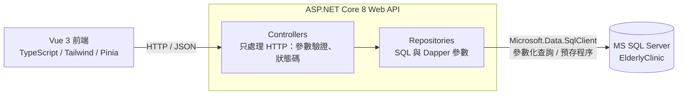

# 門診資訊系統

以長者門診為情境的練習專案：MS SQL Server 資料庫、ASP.NET Core 8 Web API（Dapper），加上 Vue 3 前端。
資料全部是假資料，不含任何真實個資。

產品範圍、介面、邊界情況與驗收標準見 [docs/PRD-elderly-clinic.md](docs/PRD-elderly-clinic.md)。

## 功能

### 資料庫（`database/`）

- 6 張資料表：Departments 科別、Doctors 醫師、Patients 病人、Appointments 掛號、VitalSigns 生命徵象、Users 系統使用者
- 約束：主鍵、外鍵、UNIQUE、CHECK（性別、診別、掛號狀態、生命徵象合理範圍）
- 篩選唯一索引：同一病人在同一醫師同一診只能有一筆有效掛號（已取消的不算）
- 預存程序 `dbo.usp_GetClinicList`：查某天（某科）的門診清單（`procedures.sql`）

### Web API（`api/`）

除了登入，所有 API 都要帶 `Authorization: Bearer {accessToken}`，沒帶或過期回 401。

| 方法 | 路徑 | 說明 | 回應 |
|---|---|---|---|
| POST | `/api/auth/login` | 登入，回傳 `accessToken`（60 分鐘有效） | 200；帳號或密碼錯誤 401；同一 IP 1 分鐘超過 5 次 429 |
| GET | `/api/auth/me` | 目前登入的使用者 | 200；401 |
| GET | `/api/clinic?date=2026-11-05&deptId=1` | 呼叫 `usp_GetClinicList` 取得門診清單，`deptId` 可不傳 | 200；date 缺少或格式錯誤 400 |
| GET | `/api/departments?includeInactive=&page=&pageSize=` | 科別清單（分頁） | 200；分頁參數錯誤 400 |
| POST | `/api/departments` | 新增科別 | 201；驗證失敗 400；代碼重複 409 |
| PUT | `/api/departments/{id}` | 修改科別（帶 `rowVersion`） | 200；400；404；代碼重複或資料已被修改 409 |
| PATCH | `/api/departments/{id}/status` | 停用或啟用科別 | 200；404；科內還有啟用中的醫師 409 |
| GET | `/api/doctors?deptId=&includeInactive=&page=&pageSize=` | 醫師清單（分頁） | 200；400 |
| POST | `/api/doctors` | 新增醫師 | 201；驗證失敗 400；科別不存在或已停用 409 |
| PUT | `/api/doctors/{id}` | 修改醫師（帶 `rowVersion`） | 200；400；404；科別已停用或資料已被修改 409 |
| PATCH | `/api/doctors/{id}/status` | 停用或啟用醫師 | 200；404；今天以後還有已掛號門診，或科別已停用時啟用 409 |
| GET | `/api/patients?keyword=&includeInactive=&page=&pageSize=` | 病人清單（分頁）。keyword 比對病歷號開頭或姓名，電話遮罩 | 200；400 |
| GET | `/api/patients/{id}` | 病人詳細資料 | 200；404 |
| POST | `/api/patients` | 新增病人，病歷號由資料庫序列產生 | 201；400 |
| PUT | `/api/patients/{id}` | 修改病人（帶 `rowVersion`） | 200；400；404；資料已被修改 409 |
| PATCH | `/api/patients/{id}/status` | 停用或啟用病人 | 200；404；今天以後還有已掛號門診 409 |
| GET | `/api/patients/{id}/vitals?days=14&page=&pageSize=` | 病人最近 N 天生命徵象（分頁），依量測時間由新到舊 | 200；days 不在 1 到 365 為 400；病人不存在 404 |
| POST | `/api/patients/{id}/vitals` | 新增一筆生命徵象 | 201；驗證失敗 400；病人不存在 404；病人已停用 409 |
| PUT | `/api/vitals/{vitalId}` | 修改一筆生命徵象（整筆取代） | 200；驗證失敗 400；紀錄不存在 404；病人已停用 409 |
| DELETE | `/api/vitals/{vitalId}` | 刪除一筆生命徵象 | 204；紀錄不存在 404；病人已停用 409 |
| PATCH | `/api/appointments/{id}/checkin` | 報到：只有 `BOOKED` 能改成 `CHECKED_IN`，在交易內依影響筆數判斷結果 | 200；掛號不存在 404；狀態不是 BOOKED 409 |

錯誤回應統一使用 ProblemDetails（RFC 9110）格式。

生命徵象驗證：數值範圍與資料表 CHECK 約束相同；至少要有一項數值；收縮壓與舒張壓要一起填，且收縮壓必須大於舒張壓；量測時間不能是未來。

分頁：`page` 從 1 開始，`pageSize` 1 到 100（預設 20），回傳 `{ items, totalCount, page, pageSize }`。
基本資料不實體刪除，改用停用（`IsActive`），歷史掛號與量測紀錄保留。修改時帶回 `rowVersion`，別人先改過會回 409。

### 登入與資安設計

| 項目 | 做法 |
|---|---|
| 身分驗證 | 登入後發 Bearer token（ASP.NET Core 8 內建，以 Data Protection 加密），60 分鐘到期 |
| 預設拒絕 | `FallbackPolicy` 要求所有 API 登入，只有登入 API 標 `[AllowAnonymous]`；新增 API 忘了加 `[Authorize]` 也不會變公開 |
| 密碼儲存 | PBKDF2-SHA256、每個帳號獨立 salt、10 萬次迭代；資料庫不存明碼 |
| 防暴力破解 | 登入 API 限流：同一 IP 每分鐘 5 次，超過回 429 |
| 防帳號列舉 | 帳號不存在或密碼錯誤回同一個 401 訊息，並同樣執行雜湊運算，回應時間一致 |
| 時序攻擊 | 雜湊比對用 `CryptographicOperations.FixedTimeEquals` |
| log | 登入失敗只記錄來源 IP，不記錄輸入的帳號與密碼 |
| SQL Injection | 全部參數化查詢 |
| 前端 token | 存在 `sessionStorage`（關閉分頁即清除），收到 401 自動登出；登出時清除畫面上的病人資料 |
| 帳號停用 | `Users.IsActive = 0` 不能登入，帳號保留供稽核 |

部署到外部前還需要：HTTPS、更換或刪除測試帳號、CORS 只允許自己的前端網域、反向代理後依 `X-Forwarded-For` 限流。

### 測試帳號

本機練習用，由 `seed.sql` 建立：帳號 `admin`，密碼 `admin`。資料庫只存雜湊值。

### 前端（`web/`）

Vue 3 + TypeScript + Tailwind CSS + Pinia（Vite）。

- 登入畫面：登入後才能使用，右上角可登出；重新整理維持登入，token 過期自動回到登入畫面，重新登入後回到原本的頁面
- 頁面（vue-router）：門診作業、病人、醫師、科別，上方導覽列切換
- 門診作業：選日期查詢門診清單，可依科別篩選；「已掛號」的列可直接報到；點選病人顯示生命徵象
- 病人：搜尋（病歷號或姓名）、分頁、新增；病人頁可編輯資料、停用或啟用，並管理生命徵象
- 醫師、科別：清單、分頁、新增、編輯、停用或啟用
- 生命徵象：最近 7 / 14 / 30 / 90 / 365 天，分頁，可新增、編輯、刪除（刪除前確認）；停用的病人只能查看
- 分頁與篩選條件放在網址，可重新整理或分享；病人搜尋關鍵字不放進網址（避免姓名留在瀏覽紀錄）
- API 錯誤（ProblemDetails）直接顯示在畫面上
- 型別直接引用 `api/types/clinic-api.ts`，與後端 DTO 共用同一份定義

## 架構



```
api/
├─ Controllers/     Clinic、Patients、Vitals、Appointments、Departments、Doctors、Auth
├─ Repositories/    每個資料表或業務主題一個，寫入結果用 WriteResult（成功 / 不存在 / 衝突）
├─ Dtos/            回傳給前端的資料類別
├─ Data/            SqlConnectionFactory（從 appsettings 讀連線字串）
├─ types/           對應 DTO 的 TypeScript interface，給前端使用
└─ api.http         VS Code / Visual Studio 可直接送出的測試請求

web/src/
├─ api/client.ts    fetch 包裝：自動帶 Bearer token，非 2xx 時解析 ProblemDetails 丟出 ApiError
├─ router/          vue-router（hash 模式）：未登入導向登入頁，登入後回到原頁面
├─ views/           LoginView、ClinicView、PatientsView、PatientDetailView、DoctorsView、DepartmentsView
├─ stores/          auth、clinic、vitals、masterData（病人／醫師／科別清單）、ui（toast、確認對話框）
├─ composables/     usePagedQuery（分頁查詢）、useListRoute（清單與網址同步）、routeQuery
└─ components/      AppLayout、ClinicList、VitalsPanel、VitalsSection、VitalForm、PaginationBar、AppDialog 等
（各資料夾的 __tests__/ 為 Vitest 單元測試）
```

## 如何執行

### 需求

- SQL Server Express（執行個體 `localhost\SQLEXPRESS`，Windows 驗證）
- .NET 8 SDK（`dotnet --list-sdks` 要看到 `8.0.xxx`）
- Node.js 22.18 以上（前端）

### 1. 建立資料庫與假資料

SSMS：依序開啟 `database/schema.sql`、`database/seed.sql`、`database/procedures.sql`，按 F5。

或用 sqlcmd（`-I` 開啟 QUOTED_IDENTIFIER，篩選索引需要）：

```powershell
cd database
sqlcmd -S localhost\SQLEXPRESS -E -I -f 65001 -i schema.sql
sqlcmd -S localhost\SQLEXPRESS -E -I -f 65001 -i seed.sql
sqlcmd -S localhost\SQLEXPRESS -E -I -f 65001 -i procedures.sql
```

`schema.sql` 會刪除並重建資料表，只能用在本機練習環境（預存程序不受影響）。
分頁測試資料已包含在 `seed.sql`：
- 病人 60 位（其中 1 位停用）：每頁 20 筆有 3 頁、每頁 50 筆有 2 頁。
- 王阿明（A000001，今天午診有掛號）有大量生命徵象：最近 14 天 54 筆、30 天 117 筆，可測試每頁 10 / 20 / 30 / 40 / 50 / 100 筆。從門診清單或病人頁點進去都看得到。
`procedures.sql` 使用 `CREATE OR ALTER`，可以重複執行。

### 2. 啟動 API

```powershell
cd api
dotnet run
```

瀏覽器會自動開啟 Swagger：<http://localhost:5268/swagger>

連線字串在 `api/appsettings.json` 的 `ConnectionStrings:ElderlyClinic`，
也可以用環境變數 `ConnectionStrings__ElderlyClinic` 覆蓋。

### 3. 啟動前端

API 保持執行，另開一個終端機：

```powershell
cd web
npm install
npm run dev
```

開啟 <http://localhost:5173>。Vite 開發伺服器會把 `/api` 轉送到 `http://localhost:5268`，
所以 API 不需要設定 CORS。

### 4. 測試

- Swagger：先用 `POST /api/auth/login` 取得 `accessToken`，按右上角「Authorize」貼上，再測其他 API。
- `api/api.http`：先送「登入」，其他請求會自動帶入 token。
- 前端單元測試（Vitest，不需要啟動 API 或資料庫）：

  ```powershell
  cd web
  npm run test:run     # 執行一次；npm test 為監看模式
  ```

  測試放在各資料夾的 `__tests__/`：網址參數與登入導向、清單與網址同步、api client、分頁查詢、各 store、分頁列與量測表單。範圍見 [docs/PRD-frontend-unit-tests.md](docs/PRD-frontend-unit-tests.md)。

報到與生命徵象的新增、修改、刪除都會真的寫入資料庫。測完想還原，依序重跑 `schema.sql`、`seed.sql`
（`seed.sql` 發現已有資料會停止，所以要先跑 `schema.sql` 清空）。

## AI 輔助開發（Claude Code）

本專案用 [Claude Code](https://claude.com/claude-code) 協作開發，專案規範寫成 AI 可讀的設定檔，
讓 AI 產出的程式碼遵守同一套架構與安全規則，而不是每次重新說明：

```
CLAUDE.md                          專案規範：架構分層、SQL 安全規則、驗證指令
.claude/skills/
├─ feature-spec/       實作前寫功能 PRD：前後端與資料庫介面、邊界情況、驗收標準，範圍以總規格為準
├─ api-spec/           只有後端的小功能寫 API 規格：介面、狀態碼、資料庫影響、驗收標準
├─ add-api-endpoint/   新增 API：Controller、Repository、DTO、TS 型別、api.http、README 一次到位
├─ db-change/          修改資料表或預存程序：同步 seed、DTO、前端型別，並說明對既有資料的影響
├─ his-security-check/ 醫療資料安全檢查：參數化查詢、個資不進 log、錯誤不洩漏內部資訊
├─ git-commit/         提交前預檢與機密掃描，產生繁體中文 Angular 規範的 commit 訊息
├─ vue-conventions/    前端規範：元件、Pinia、API 呼叫、共用型別、病人個資不進 localStorage / URL
├─ frontend-feature/   新增前端功能：API 方法、store、元件、四種畫面狀態、瀏覽器實測
├─ unit-test/          前端單元測試（Vitest + @vue/test-utils）：純函式、api client、store、元件
└─ ui-review/          展示前前端檢查：型別一致、競態、錯誤處理、個資、無障礙、RWD
```

開發流程：`feature-spec` 寫 PRD（只有後端時用 `api-spec`），`add-api-endpoint` 實作後端，`frontend-feature` 實作前端，`his-security-check` 與 `ui-review` 檢查，`git-commit` 提交。

AI 負責產生草稿，所有變更都經過人工閱讀、`dotnet build` 與實際呼叫 API 驗證。

## 注意事項

- 假資料的掛號與量測日期由 `seed.sql` 依「執行當天」計算。文件中的 `date=2026-11-05` 只是範例，請換成你執行 seed 的那一天；隔天測試前先重跑 `schema.sql` 和 `seed.sql`。
- vitals 的「最近 N 天」以資料庫當下時間 `SYSDATETIME()` 往回算。
- `usp_GetClinicList` 回傳 `AppointmentId`、`PatientId`，前端用來直接報到與查詢生命徵象。更新預存程序後要重跑 `procedures.sql`。
