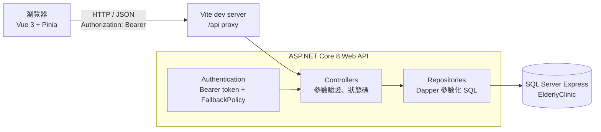
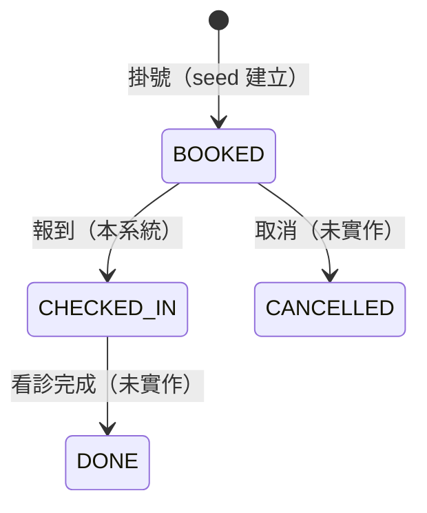
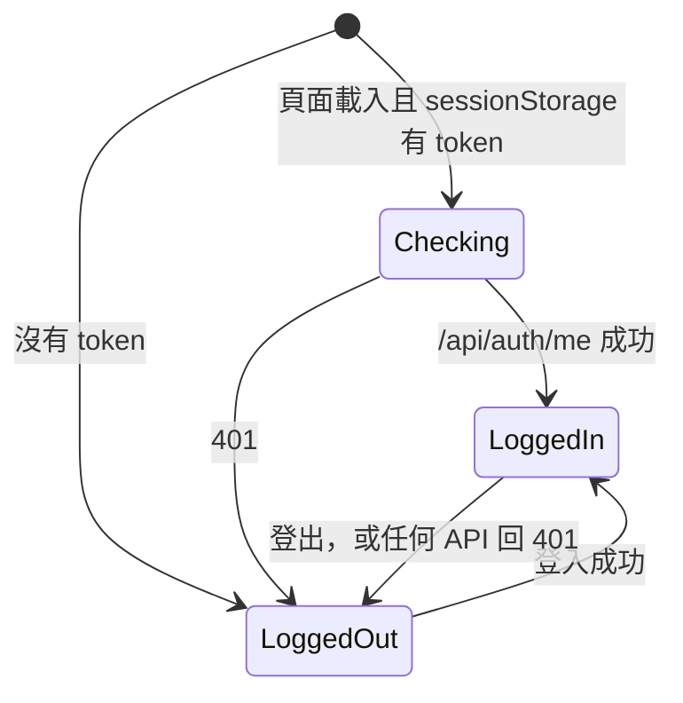

# PRD：門診資訊系統（elderly-clinic）

> 版本：1.4.0 ｜ 狀態：進行中（Should 未實作） ｜ 最後更新：2026-11-12

> 全專案總規格。功能 PRD（`PRD-<slug>.md`）的範圍必須落在本文件之內；需要超出時，先更新本文件。

## 背景與目標

長者門診的護理站每天要處理兩件事：確認當天門診清單、替到院的長者報到，以及持續追蹤血壓、血糖等生命徵象。本專案以這個情境做一套最小可用的門診資訊系統，資料全部是假資料。

目標：

1. **完整串接**：資料庫、Web API、前端三層都實作，操作結果真的寫入 MS SQL Server。
2. **像正式系統一樣溝通**：登入取得 token，所有 API 需要 `Authorization: Bearer`，錯誤一律 ProblemDetails。
3. **醫療資料安全**：參數化查詢、輸入驗證、個資不進 log、密碼只存雜湊、防暴力破解。
4. **可展示、可說明**：每個設計決策都能在面試中說出理由，文件與程式碼一致。

## 範圍

**Must（已完成）**

- 登入、登出；未登入不能使用任何功能
- 查詢某天門診清單，依科別篩選
- 報到：只有「已掛號」能改成「已報到」
- 查詢病人最近 N 天生命徵象
- 生命徵象新增、修改、刪除

**Must（已完成，見 [PRD-master-data.md](PRD-master-data.md)）**

- 導覽列與多頁面（`vue-router`）；空狀態引導使用者到可操作的頁面
- 病人、醫師、科別基本資料：新增、編輯、停用與啟用（軟刪除）
- 所有清單伺服器端分頁（含生命徵象）

**Must（見 [PRD-frontend-unit-tests.md](PRD-frontend-unit-tests.md)）**

- 前端單元測試：網址參數與登入導向、api client、分頁查詢、store、關鍵元件

**Should（尚未實作）**

- 生命徵象異動稽核：記錄新增、修改、刪除的人與時間
- 生命徵象改為軟刪除
- 帳號連續登入失敗鎖定

**Could**

- 角色權限（護理師、管理者）
- 生命徵象趨勢圖
- 取消掛號
- 從 OpenAPI 自動產生前端 TypeScript 型別

**Won't**

- 真實病人資料、身分證字號等欄位
- 掛號建立、排班、醫囑、處方、批價
- 多院區、多語系
- 正式部署（本專案只在本機執行；部署前需補項目見「風險與待決策」）

## 使用者與使用情境

| 角色 | 情境 |
|------|------|
| 門診護理師 | 我想要看到今天各診的病人與看診號，以便安排報到與量測順序 |
| 門診護理師 | 長者到院後，我想要一鍵完成報到，以便醫師知道病人已到 |
| 門診護理師 | 我想要記錄長者今天量的血壓、心跳，打錯時能修改或刪除，以便病歷正確 |
| 醫師 | 我想要看到病人最近兩週的生命徵象，以便判斷用藥是否需要調整 |

## 系統架構



### 技術選型

| 層 | 技術 | 理由 |
|----|------|------|
| 資料庫 | SQL Server Express | 醫院 HIS 常用；約束、篩選索引、預存程序都能展示 |
| 後端 | ASP.NET Core 8 Web API、Dapper | SQL 由自己掌握，方便說明每一句查詢；Dapper 輕量 |
| 驗證 | ASP.NET Core 8 內建 Bearer token、Rate Limiter | 不另外加套件，降低相依與維護成本 |
| 前端 | Vue 3、TypeScript、Pinia、Tailwind CSS v4、Vite | 型別安全；狀態集中；開發時用 proxy 免設 CORS |

### 目錄

```
database/   schema.sql（重建資料表）、seed.sql（假資料）、procedures.sql（預存程序）
api/        Controllers、Repositories、Dtos、Security、types/clinic-api.ts（前端共用型別）
web/        src/api/client.ts、src/stores/、src/components/
docs/       PRD 與規格
```

## 資料與介面

### 資料表

| 資料表 | 用途 | 重點約束 |
|--------|------|----------|
| Departments | 科別 | `DeptCode` UNIQUE |
| Doctors | 醫師 | FK 到科別；`IsActive` 標記在職 |
| Patients | 病人 | `ChartNo` 病歷號 UNIQUE；`Gender` CHECK |
| Appointments | 掛號 | `Status` CHECK；同醫師同日同診看診號 UNIQUE；篩選唯一索引防重複掛號（已取消不算） |
| VitalSigns | 生命徵象 | 各數值 CHECK 合理範圍，可為 NULL |
| Users | 系統使用者 | `Username` UNIQUE；`PasswordHash` 只存 PBKDF2 雜湊；`IsActive` 停用而不刪除 |

假資料：5 科、8 位醫師（1 位離職）、20 位病人、約 30 筆掛號、約 280 筆生命徵象、1 個測試帳號。掛號與量測日期依執行 `seed.sql` 當天計算。

### API

除登入外都需要 `Authorization: Bearer {accessToken}`，未帶或過期回 401。錯誤回應一律 ProblemDetails。

| 方法 | 路徑 | 說明 | 回應 |
|------|------|------|------|
| POST | `/api/auth/login` | 登入，回傳 `accessToken`（60 分鐘） | 200；401；429 |
| GET | `/api/auth/me` | 目前使用者 | 200；401 |
| GET | `/api/clinic?date=&deptId=` | 門診清單（呼叫 `usp_GetClinicList`，不含已取消） | 200；400 |
| PATCH | `/api/appointments/{id}/checkin` | 報到 | 200；404；409 |
| GET | `/api/patients/{id}/vitals?days=` | 最近 N 天生命徵象，`days` 1 到 365 | 200；400；404 |
| POST | `/api/patients/{id}/vitals` | 新增生命徵象 | 201；400；404 |
| PUT | `/api/vitals/{vitalId}` | 修改生命徵象（整筆取代） | 200；400；404 |
| DELETE | `/api/vitals/{vitalId}` | 刪除生命徵象 | 204；404 |

生命徵象輸入規則：數值範圍與資料表 CHECK 相同（收縮壓 50–260、舒張壓 30–160、心跳 20–250、血糖 20–800、體重 10–300）；至少一項數值；收縮壓與舒張壓成對；量測時間不得晚於現在 5 分鐘。

型別：C# DTO 與 `api/types/clinic-api.ts` 一一對應（camelCase），前端以 `@api-types/clinic-api` 直接引用，不重複定義。

### 前端畫面

| 區塊 | 內容 |
|------|------|
| 登入畫面 | 帳號、密碼；錯誤時顯示「帳號或密碼錯誤」或「嘗試次數過多」 |
| 頁首 | 系統名稱、使用者顯示名稱、登出 |
| 門診清單 | 日期、科別篩選、查詢；狀態徽章；「已掛號」列顯示報到按鈕 |
| 生命徵象面板 | 選取的病人、天數切換、新增量測、每列編輯與刪除 |

寬螢幕（`lg` 以上）兩欄，窄螢幕單欄上下排列；文案不使用方位詞。

## 狀態與流程

### 掛號狀態



### 登入狀態（前端）



## 邊界情況

| 編號 | 情境 | 預期行為 |
|------|------|----------|
| EC-01 | 未帶 token 或 token 偽造、過期 | 401；前端自動回登入畫面 |
| EC-02 | 帳號不存在或密碼錯誤 | 同一個 401 訊息，回應時間一致 |
| EC-03 | 同一 IP 一分鐘內登入超過 5 次 | 429 |
| EC-04 | 門診清單日期缺少或格式錯誤 | 400 |
| EC-05 | 報到時掛號不存在／狀態不是 BOOKED | 404／409，狀態不變 |
| EC-06 | 兩人同時報到同一筆 | 條件式 UPDATE，只有一人成功，另一人 409 |
| EC-07 | 生命徵象數值超出範圍、只填收縮壓、沒有任何數值 | 400，不寫入 |
| EC-08 | 新增時病人不存在／修改刪除時紀錄不存在 | 404 |
| EC-09 | 快速切換病人或天數，舊回應晚到 | 以請求序號丟棄過期回應 |
| EC-10 | 重新查詢門診清單 | 清空生命徵象面板 |
| EC-11 | 登出 | 清除 token 與畫面上的病人資料 |
| EC-12 | API 停止或資料庫無法連線 | 前端顯示錯誤訊息；後端回 ProblemDetails 500，不洩漏堆疊 |

## 非功能需求

**資安**

- SQL 全部參數化，禁止字串組 SQL
- 所有 API 預設需登入（`FallbackPolicy`），只有登入 API 允許匿名
- 密碼 PBKDF2-SHA256、獨立 salt、10 萬次迭代；固定時間比對
- 登入限流：每 IP 每分鐘 5 次
- log 不記錄病人個資，登入失敗不記錄輸入的帳號密碼
- 前端 token 存 `sessionStorage`；病人資料不寫入 storage、URL 或 console
- 錯誤回應不含例外訊息與堆疊

**品質**

- `dotnet build` 0 warning、0 error；`npm run build`（含 `vue-tsc`）無錯誤
- 每支 API 在 `api/api.http` 有成功與錯誤情境請求
- RWD：400px 寬不破版，寬表格可水平捲動

## 驗收標準

- [x] AC-01：Given 未登入，When 開啟網站，Then 只顯示登入畫面
- [x] AC-02：Given 測試帳號，When 登入，Then 進入主畫面並顯示使用者名稱；重新整理後仍維持登入
- [x] AC-03：Given 已登入，When 查詢有資料的日期，Then 顯示門診清單，可依科別篩選
- [x] AC-04：Given 一筆「已掛號」，When 按報到，Then 狀態變成「已報到」且資料庫同步更新；再次報到回 409
- [x] AC-05：Given 選取病人，When 新增一筆合法量測，Then 列表出現該筆且資料庫有新資料列
- [x] AC-06：Given 一筆量測，When 修改後儲存，Then 列表與資料庫都更新
- [x] AC-07：Given 一筆量測，When 確認刪除，Then 列表移除且資料庫刪除（API 回 204）
- [x] AC-08：EC-01 到 EC-11 皆通過（API 以 curl 與 `api.http` 驗證，前端以瀏覽器操作驗證）
- [ ] AC-09：Should 範圍（稽核、軟刪除、帳號鎖定）完成
- [x] AC-10：基本資料維護與分頁完成（[PRD-master-data.md](PRD-master-data.md) 驗收標準全部通過）

## 風險與待決策

| 項目 | 說明 | 處理方式 |
|------|------|----------|
| 測試帳密公開 | 展示用，README 與 `api.http` 明列 | 部署時不跑 seed 帳號，改用環境變數建立 |
| 無 HTTPS | 本機 http | 部署時強制 HTTPS |
| 無稽核紀錄 | 看不出誰改了生命徵象 | Should：加 `CreatedBy`、`UpdatedBy` 或異動紀錄表 |
| 硬刪除 | 刪錯無法復原 | Should：軟刪除 |
| 無角色 | 登入者都能改刪 | Could：角色權限 |
| token 無法撤銷 | 登出只在前端丟棄 token | 縮短效期或後端記錄 token 版本 |
| 限流只看 IP、存在記憶體 | 換 IP 可繞過；重啟歸零；反向代理後共用 IP | Should：帳號鎖定；部署時依 `X-Forwarded-For` |
| seed 日期依執行日 | 隔天查不到「今天」的門診 | 展示前重跑 `schema.sql`、`seed.sql` |

## 變更紀錄

| 日期 | 內容 |
|------|------|
| 2026-11-07 | 資料表、假資料、門診清單預存程序；三支 API（門診清單、生命徵象查詢、報到） |
| 2026-11-11 | Vue 3 前端；門診清單回傳 AppointmentId、PatientId |
| 2026-11-11 | 登入與 Bearer token、生命徵象新增修改刪除、登入限流 |
| 2026-11-11 | 查詢時清空生命徵象面板；文案不使用方位詞；建立本 PRD |
| 2026-11-11 | 範圍新增基本資料維護與分頁（PRD-master-data，規劃中） |
| 2026-11-11 | 完成基本資料維護（病人、醫師、科別）、vue-router 多頁、伺服器端分頁、停用規則與樂觀併發 |
| 2026-11-11 | 每頁筆數改為 10 / 20 / 30 / 40 / 50 / 100；分頁測試資料併入 `seed.sql`（60 位病人、王阿明 117 筆生命徵象），刪除 10 萬筆腳本 |
| 2026-11-11 | 前端 UI 規範統一（[PRD-ui-standards.md](PRD-ui-standards.md)）：共用樣式、頁面標題、分頁置底、表格與表單慣例 |
| 2026-11-11 | 文件流程：所有 PRD 加上版本、狀態與變更紀錄；修改後以 `prd-sync` 同步，程式與 PRD 同一個 commit、一起回滾 |
| 2026-11-12 | 測試帳號改為 `admin`（密碼見 README「測試帳號」） |
| 2026-11-12 | 新增 `unit-test` skill（取代 `add-tests`）：前端單元測試規範與流程 |
| 2026-11-12 | 範圍新增前端單元測試（[PRD-frontend-unit-tests.md](PRD-frontend-unit-tests.md)）：Vitest + @vue/test-utils + jsdom |
| 2026-11-12 | 單元測試發現並修正清單重複查詢（網址預設值、超出頁碼修正網址）；PRD-master-data 1.2.2 |
