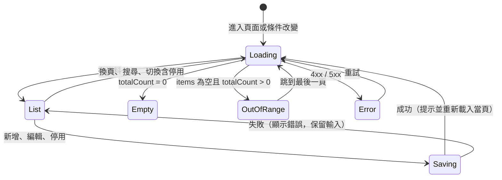

# PRD：基本資料維護與分頁（master-data）

> 版本：1.2.1 ｜ 狀態：完成 ｜ 最後更新：2026-11-11

## 目標

目前登入後只有門診作業一個畫面：當天沒有門診時畫面幾乎是空的，使用者找不到新增或編輯資料的入口；生命徵象只能從門診清單點進去才能維護。本功能新增病人、醫師、科別的基本資料維護頁，重新規劃導覽與空狀態，並為所有清單加上伺服器端分頁，資料量大時仍能快速查詢。對應總規格「基本資料維護」。

## 決策

| 項目 | 決定 | 理由 |
|------|------|------|
| 資料範圍 | 病人、醫師、科別；生命徵象改為分頁並移到病人詳細頁也能維護 | 掛號會用到的基本資料都能管理 |
| 刪除 | 停用（軟刪除，`IsActive = 0`），可重新啟用；不提供實體刪除 | 病人、醫師被掛號與生命徵象參照；醫療資料要可追溯 |
| 頁面切換 | 加入 `vue-router`（hash 模式） | 每頁有自己的網址，重新整理停在同一頁；部署位置未定，hash 模式不需伺服器設定 |
| 權限 | 登入者都可維護 | 角色權限維持總規格 Could |
| 分頁 | 伺服器端分頁（`OFFSET ... FETCH`），一次最多 100 筆 | 資料量大時不一次載入；前端只拿當頁 |
| 病歷號 | 系統以 SEQUENCE 產生 `A` + 6 位數，建立後不可修改 | 避免人工輸入重複；併發新增不會拿到同一號 |
| 搜尋關鍵字 | 不放進網址 | 病人姓名屬個資，網址會留在瀏覽紀錄與伺服器 log |

## 範圍

**Must**

- 導覽列：門診作業、病人、醫師、科別；目前所在頁面有明顯標示
- 病人：清單（關鍵字搜尋、含停用切換、分頁）、新增、編輯、停用與啟用、詳細頁
- 病人詳細頁：基本資料與生命徵象（新增、編輯、刪除、分頁）同頁維護
- 醫師：清單（科別篩選、含停用切換、分頁）、新增、編輯、停用與啟用
- 科別：清單（含停用切換、分頁）、新增、編輯、停用與啟用
- 生命徵象查詢改為分頁
- 共用元件：分頁列、確認對話框、儲存成功提示
- 空狀態都有下一步引導（說明＋可點的連結或按鈕）
- 未登入時造訪任何頁面都導向登入，登入後回到原頁面

**Should**

- `seed.sql` 內含分頁測試資料：60 位病人、一位病人有大量生命徵象（使用者決定不保留大量資料腳本，見開發紀錄）
- 樂觀併發控制：兩人同時編輯同一筆，後存的人收到 409 並提示重新載入（`ROWVERSION`）
- 病人清單電話遮罩（`0900-***-001`），詳細頁才顯示完整電話

**Won't**

- 實體刪除病人、醫師、科別
- 異動稽核紀錄（總規格 Should，另開 PRD）
- 角色權限、批次匯入匯出
- 門診清單分頁（單日筆數有限；另評估）

## 使用情境

- 身為門診護理師，登入後我想要一眼看到能做哪些事，以便不用猜功能在哪裡。
- 身為門診護理師，我想要用病歷號或姓名找到病人，直接替他新增生命徵象，以便長者不在當天門診清單上也能記錄。
- 身為櫃台人員，我想要建立新病人並修正電話與緊急聯絡人，以便聯絡家屬。
- 身為行政人員，醫師離職時我想要停用而不是刪除，以便舊的掛號紀錄仍看得到醫師姓名。

## 資料與介面

### 資料庫（`db-change`）

| 變更 | 內容 |
|------|------|
| `Patients.IsActive` | `BIT NOT NULL DEFAULT 1`（`DF_Patients_IsActive`） |
| `Departments.IsActive` | `BIT NOT NULL DEFAULT 1`（`DF_Departments_IsActive`） |
| `Doctors.IsActive` | 已存在 |
| `dbo.seq_ChartNo` | `SEQUENCE`，起始值大於 seed 最大病歷號；新增病人時 `'A' + FORMAT(NEXT VALUE FOR ..., '000000')` |
| 索引 | `IX_Patients_IsActive_ChartNo (IsActive, ChartNo)`、`IX_Doctors_DeptId (DeptId, IsActive)`；`IX_VitalSigns_Patient_MeasuredAt` 已存在 |
| Should | 三張表加 `RowVersion ROWVERSION` |

對既有資料：新欄位有預設值，既有資料列全部視為啟用。需重跑 `schema.sql`、`seed.sql`（會清除本機資料）。

回復方式：`ALTER TABLE ... DROP CONSTRAINT DF_...; ALTER TABLE ... DROP COLUMN IsActive; DROP SEQUENCE dbo.seq_ChartNo;`

### 分頁共用規則

- 參數：`page`（從 1 開始，預設 1）、`pageSize`（1 到 100，預設 20）；超出範圍回 400
- 回應：

  ```json
  { "items": [], "totalCount": 0, "page": 1, "pageSize": 20 }
  ```

- `page` 超過最後一頁：回 200、`items` 為空、`totalCount` 照實回傳；前端自動跳到最後一頁
- 排序固定且含唯一鍵作為最後排序條件，確保換頁時不重複、不遺漏
- 同一連線一次往返取得總筆數與當頁資料（Dapper `QueryMultiple`）

### API

所有 API 需要登入。停用與啟用一律 `PATCH .../status`，body `{ "isActive": true | false }`。

| 方法 | 路徑 | 說明 | 回應 |
|------|------|------|------|
| GET | `/api/patients?keyword=&includeInactive=false&page=&pageSize=` | 病人清單，依 `ChartNo` 排序 | 200；400 |
| GET | `/api/patients/{id}` | 病人基本資料 | 200；404 |
| POST | `/api/patients` | 新增病人，系統產生病歷號 | 201；400 |
| PUT | `/api/patients/{id}` | 修改病人（病歷號不可改） | 200；400；404；409（Should：版本衝突） |
| PATCH | `/api/patients/{id}/status` | 停用或啟用 | 200；404；409 |
| GET | `/api/doctors?deptId=&includeInactive=false&page=&pageSize=` | 醫師清單，依科別代碼、姓名、`DoctorId` 排序 | 200；400 |
| POST | `/api/doctors` | 新增醫師 | 201；400；409（科別已停用） |
| PUT | `/api/doctors/{id}` | 修改醫師 | 200；400；404；409 |
| PATCH | `/api/doctors/{id}/status` | 停用或啟用 | 200；404；409 |
| GET | `/api/departments?includeInactive=false&page=&pageSize=` | 科別清單，依 `DeptCode` 排序 | 200；400 |
| POST | `/api/departments` | 新增科別 | 201；400；409（代碼重複） |
| PUT | `/api/departments/{id}` | 修改科別 | 200；400；404；409 |
| PATCH | `/api/departments/{id}/status` | 停用或啟用 | 200；404；409 |
| GET | `/api/patients/{id}/vitals?days=&page=&pageSize=` | **改為分頁回應**，依 `MeasuredAt DESC, VitalId DESC` | 200；400；404 |

`GET /api/patients/{id}/vitals` 回應由陣列改為分頁物件，屬破壞性變更；目前只有本專案前端使用，同一個 commit 一起改。

### 欄位驗證

| 資料 | 規則 |
|------|------|
| 病人 | `PatientName` 必填 1–50 字；`Gender` 為 `M` 或 `F`；`BirthDate` 必填，介於 1900-01-01 與今天；`Phone`、`EmergencyPhone` 選填，最多 20 字，只允許數字、`-`、`+`、空白；`Address` 最多 200 字；`EmergencyContact` 最多 50 字 |
| 醫師 | `DeptId` 必填且為啟用中的科別；`DoctorName` 必填 1–50 字；`Title` 必填 1–20 字 |
| 科別 | `DeptCode` 必填 2–10 字，大寫英文與數字；`DeptName` 必填 1–50 字 |
| 關鍵字 | 去除前後空白，最多 50 字；比對病歷號開頭或姓名包含；`%`、`_`、`[` 先跳脫再當參數傳入 |

### 停用規則

停用以單一 `UPDATE ... WHERE ... AND NOT EXISTS (...)` 完成，依影響筆數判斷；0 筆時再查一次，區分 404 與 409（同報到 API 的做法）。

| 對象 | 不能停用的情況（409） |
|------|------------------------|
| 科別 | 仍有在職醫師 |
| 醫師 | 今天以後仍有 `BOOKED` 掛號 |
| 病人 | 今天以後仍有 `BOOKED` 掛號 |

停用後：清單預設不顯示；下拉選單不出現；已停用病人不能新增或修改生命徵象（409），既有紀錄仍可查看；門診清單與歷史資料照常顯示姓名。

### 型別（`api/types/clinic-api.ts`）

新增 `PagedResult<T>`、`PatientListItem`、`Patient`、`PatientInput`、`Doctor`、`DoctorInput`、`Department`、`DepartmentInput`、`StatusInput`；`getVitals` 回傳型別改為 `PagedResult<VitalSign>`。

### 前端

**路由**（`vue-router`，hash 模式，路由頁面 lazy load）

| 路徑 | 頁面 | 說明 |
|------|------|------|
| `/login` | LoginView | 已登入時導向 `/clinic` |
| `/clinic` | ClinicView | 現有門診作業（預設首頁） |
| `/patients` | PatientsView | 病人清單 |
| `/patients/new` | PatientDetailView | 新增病人 |
| `/patients/:id` | PatientDetailView | 基本資料＋生命徵象 |
| `/doctors` | DoctorsView | 醫師清單，新增與編輯用對話框 |
| `/departments` | DepartmentsView | 科別清單，新增與編輯用對話框 |

- 路由守衛：未登入導向 `/login?redirect=<原路徑>`；`redirect` 只接受 `/` 開頭的站內路徑，避免開放重新導向
- `page`、`pageSize`、`includeInactive`、`deptId` 同步到網址 query；`keyword` 只存在 Pinia store
- 不合法的 query（例如 `page=abc`）回到預設值

**版面**：頁首放系統名稱、導覽列、使用者與登出；窄螢幕導覽列可水平捲動。

**共用元件**

- `PaginationBar`：「共 N 筆」、上一頁、頁碼（最多顯示 5 個，其餘以「…」表示）、下一頁、每頁 10 / 20 / 30 / 40 / 50 / 100 筆（預設 20）；只有一頁時隱藏頁碼
- `ConfirmDialog`：取代瀏覽器 `confirm()`；開啟時焦點在「取消」，`Esc` 關閉，關閉後焦點回到觸發按鈕
- `ToastMessage`：「已儲存」「已停用」等提示，3 秒消失，`aria-live="polite"`
- `StatusBadge`：啟用／停用，顏色加文字

**空狀態與引導**

| 位置 | 文案與動作 |
|------|------------|
| 門診清單沒有資料 | 「這一天沒有門診。可以改選其他日期，或到病人頁查詢病人、新增生命徵象。」＋「前往病人」按鈕 |
| 生命徵象面板未選病人 | 「點選門診清單中的病人，查看生命徵象。也可以到病人頁查詢任何病人。」 |
| 病人清單搜尋無結果 | 「找不到符合「{關鍵字}」的病人。」＋「新增病人」按鈕 |
| 清單完全沒有資料 | 「還沒有資料。」＋「新增 xxx」按鈕 |
| 生命徵象沒有紀錄 | 「這段期間沒有量測紀錄。」＋「新增量測」按鈕 |

**Store**：`patients`、`doctors`、`departments` 各一個 store，管理查詢條件、當頁資料、`loading`、`error`、請求序號；登出時 `reset()`。生命徵象的 CRUD 抽成可在門診面板與病人詳細頁共用的元件。

## 狀態與流程



## 邊界情況

| 編號 | 情境 | 預期行為 |
|------|------|----------|
| EC-01 | `page` 為 0、負數或 `pageSize` 超過 100 | 400 |
| EC-02 | `page` 超過最後一頁（例如停用最後一頁唯一一筆後） | API 回空陣列；前端跳到最後一頁 |
| EC-03 | 換頁期間有人新增資料 | 依固定排序與唯一鍵，同一頁內不重複；不保證跨頁快照（說明於畫面無須處理） |
| EC-04 | 關鍵字含 `%`、`_`、`'`、`[` | 當一般文字比對，不報錯、不被當萬用字元 |
| EC-05 | 兩人同時新增病人 | 各自取得不同病歷號 |
| EC-06 | 科別代碼重複（含併發新增） | 409「科別代碼已存在」 |
| EC-07 | 停用仍有在職醫師的科別／仍有未來掛號的醫師或病人 | 409，訊息說明原因 |
| EC-08 | 新增醫師時選到剛被停用的科別 | 409 |
| EC-09 | 已停用病人新增生命徵象 | 409 |
| EC-10 | 編輯中途 token 過期 | 回登入頁，登入後回到原頁面；未儲存的輸入不保留（畫面提示） |
| EC-11 | 快速連續換頁或輸入關鍵字 | 以請求序號丟棄過期回應；關鍵字輸入 300ms 後才查詢 |
| EC-12 | 直接開 `/#/patients/999999` | 顯示「找不到這位病人」＋「回病人清單」 |
| EC-13 | `redirect` 參數為外部網址 | 忽略，導向 `/clinic` |
| EC-14 | 儲存按鈕連點 | 第一次送出後停用按鈕，只送出一次 |
| EC-15 | Should：兩人同時編輯同一筆 | 後存者 409「資料已被其他人修改，請重新載入」 |

## 非功能需求

- **效能**：10 萬位病人時，病人清單 API（含搜尋）p95 < 300ms，開發時量測一次，結果寫入開發紀錄（Should；大量資料腳本不保留）
- **資安**：全部參數化查詢；排序欄位固定，不接受使用者指定欄位名稱；關鍵字不進網址與 log；所有新 API 受 `FallbackPolicy` 保護；ProblemDetails 不含內部資訊
- **RWD**：400px 寬不破版；表格可水平捲動；導覽列可水平捲動；文案不寫方位詞
- **無障礙**：導覽目前頁面加 `aria-current="page"`；對話框焦點管理；表單欄位都有 `<label>`；錯誤訊息 `role="alert"`
- **套件**：新增 `vue-router`（已同意）；其他不新增

## 驗收標準

- [x] AC-01：Given 已登入，When 進入任何頁面，Then 頁首導覽列顯示門診作業、病人、醫師、科別，目前頁面有標示
- [x] AC-02：Given 當天沒有門診，When 開啟門診作業，Then 顯示引導文案與「前往病人」按鈕，點擊後進入病人清單
- [x] AC-03：Given 病人清單，When 輸入病歷號開頭或姓名片段，Then 300ms 後顯示符合的病人與總筆數
- [x] AC-04：Given 病人超過 20 位，When 點第 2 頁，Then 顯示第 21–40 筆，網址 query 為 `page=2`，重新整理後仍在第 2 頁
- [x] AC-05：Given 新增病人表單，When 填寫合法資料並儲存，Then 回 201、顯示「已新增病人，病歷號 Axxxxxx」、進入該病人詳細頁且病歷號由系統產生
- [x] AC-06：Given 病人詳細頁，When 修改電話並儲存，Then 資料庫更新、`UpdatedAt` 更新
- [x] AC-07：Given 病人詳細頁，When 新增、編輯、刪除生命徵象，Then 結果與門診面板一致，生命徵象清單可分頁
- [x] AC-08：Given 沒有未來掛號的病人，When 停用並在確認對話框按確定，Then 清單預設不再顯示；勾選「含停用」後可看到並重新啟用
- [x] AC-09：Given 有未來 `BOOKED` 掛號的病人／醫師，When 停用，Then 409 且畫面說明原因
- [x] AC-10：Given 醫師清單，When 新增醫師，Then 科別下拉只列啟用中的科別
- [x] AC-11：Given 科別代碼已存在，When 新增同代碼科別，Then 409「科別代碼已存在」
- [x] AC-12：Given 未登入，When 直接開 `/#/doctors`，Then 導向登入，登入後回到醫師頁
- [x] AC-13：EC-01 到 EC-14 皆通過（API 以 `api.http`，前端以瀏覽器操作）
- [x] AC-14：400px 寬下所有頁面不破版、可操作
- [x] AC-15：Should：`seed.sql` 執行後，病人清單與王阿明（A000001）的生命徵象在每頁 10 到 100 筆下都能看到換頁效果

## 實作順序

1. `db-change`：`IsActive`、SEQUENCE、索引，更新 seed
2. `add-api-endpoint`：分頁共用型別與 Repository 寫法 → 科別 → 醫師 → 病人 → 生命徵象改分頁
3. `frontend-feature`：`vue-router` 與版面、登入守衛 → 共用元件 → 科別、醫師頁 → 病人清單與詳細頁 → 門診頁空狀態
4. `his-security-check`、`ui-review`；更新 README、總規格、`api.http`
5. Should：分頁測試資料與效能量測、樂觀併發、電話遮罩

## 開發紀錄

完成日期：2026-11-11。實作順序與 PRD 相同（資料庫、API、前端、文件、Should）。

**實際做法**

- 資料庫：`Departments`、`Patients` 加 `IsActive`；三張表加 `ROWVERSION`；`dbo.seq_ChartNo` 序列當 `ChartNo` 的 DEFAULT（`A` + 6 碼）；索引 `IX_Doctors_DeptId (DeptId, IsActive)`、`IX_Patients_IsActive_ChartNo (IsActive, ChartNo) INCLUDE (...)`。`seed.sql` 加一個停用科別（耳鼻喉科）、40 位分頁測試病人（共 60 位，1 位停用），以及王阿明 30 天、每天 4 次的生命徵象（最近 14 天 54 筆、30 天 117 筆）。
- API：`PageQuery` / `PagedResult<T>` 共用；清單用 `QueryMultiple` 一次取回總筆數與當頁（`OFFSET ... FETCH`，排序最後一欄為主鍵）。寫入一律單一 SQL 敘述，以 `OUTPUT` 或影響筆數判斷結果，回傳 `WriteResult<T>`（成功／不存在／衝突），Controller 用 `ToProblem` 轉成 404 / 409。唯一鍵衝突（2627 / 2601）轉成 409。關鍵字以 `ESCAPE ''` 處理萬用字元，`VARCHAR` 參數用 `DbString IsAnsi` 讓索引可用，可選條件加 `OPTION (RECOMPILE)`。
- 前端：`vue-router` hash 模式、頁面 lazy load；`beforeEach` 等待 `auth.restore()` 後判斷登入；`safeRedirect` 只接受站內路徑。清單頁共用 `usePagedQuery`（請求序號、超出頁碼自動跳最後一頁）與 `useListRoute`（網址是唯一來源：操作改網址，網址變動才查詢，重新整理與上一頁都能還原）。生命徵象抽成 `VitalsSection` 與 `vitals` store，門診面板與病人詳細頁共用。

**與 PRD 的差異**

- AC-05 的提示文字改為「已新增病人，病歷號 Axxxxxx」，讓使用者立即知道系統產生的病歷號。
- 生命徵象天數選項加上 365 天（API 原本就允許 1 到 365）。
- 病人詳細頁在病人停用時，生命徵象區塊改為唯讀並顯示說明，而不是等送出才回 409。
- `/patients/:id` 與 `/patients` 是同層路由，導覽列改用路徑開頭判斷目前頁面，病人詳細頁也會標示「病人」。
- 窄螢幕表格儲存格不換行（`whitespace-nowrap`），改由外層水平捲動，避免姓名被拆成直排。

**驗證方式**

- `dotnet build` 0 error 0 warning；`npm run build`（vue-tsc + vite）無錯誤。
- API：Python 腳本 47 項全部通過，涵蓋 EC-01、EC-02、EC-04 到 EC-09、EC-15（分頁參數 400、超出頁碼回空陣列、`%` 當一般文字、病歷號序列、代碼重複 409、rowversion 衝突 409、停用規則 409、停用病人生命徵象 409、電話遮罩）。
- 瀏覽器：登入後導回原頁（AC-12、EC-13 由 `safeRedirect` 處理）、導覽標示（AC-01）、門診無資料引導（AC-02）、搜尋與關鍵字不進網址（AC-03）、第 2 頁與 `page=99` 自動修正為最後一頁並寫回網址（AC-04、EC-02）、新增病人（AC-05）、修改電話後資料庫 `Phone` 與 `UpdatedAt` 更新（AC-06）、病人詳細頁新增生命徵象（AC-07）、停用病人後唯讀（AC-08）、停用仍有醫師的科別顯示 409 原因（AC-09 同類規則）、新增醫師時停用科別不預選也不在下拉（AC-10）、`/#/patients/99999` 顯示找不到（EC-12）、400px 寬病人清單與詳細頁無水平捲動（AC-14，以 400px iframe 檢查）。
- 生命徵象的編輯、刪除沿用門診面板已驗證的元件，本次在病人詳細頁只實測新增。

**效能量測（一次性）**

開發時曾以暫時腳本產生 10 萬位病人量測（共 100,020 位，本機 SQL Server Express，每種查詢暖機 1 次再量 10 次）。使用者認為展示不需要這麼多資料，量測後刪除該腳本，改在 `seed.sql` 放少量但能測出分頁的資料（AC-15 隨之修改）。

| 查詢 | 符合筆數 | p50 | p95 |
|------|---------:|----:|----:|
| 第 1 頁 | 100,020 | 6.4 ms | 6.8 ms |
| 最後一頁（第 5,001 頁） | 100,020 | 15.3 ms | 15.8 ms |
| 病歷號開頭 `A0500` | 100 | 54.8 ms | 57.0 ms |
| 姓名包含「王」 | 10,001 | 37.8 ms | 40.0 ms |
| 含停用、第 2,500 頁 | 100,020 | 30.5 ms | 31.4 ms |

全部低於 300 ms。

**資安備註**

- 病人搜尋關鍵字只存在 Pinia store，不進瀏覽器網址列與瀏覽紀錄；但仍會出現在送給 API 的請求 query string。ASP.NET Core log 等級為 Warning，不會記錄請求網址；部署到反向代理時要確認代理的 access log 不記錄 query string，或改用 POST 搜尋。
- 清單 API 的電話一律遮罩，只有詳細資料 API 回傳完整電話。
- 生命徵象的 PUT / DELETE 對停用病人也回 409，與新增一致。

## 變更紀錄

| 版本 | 日期 | 類型 | 內容 | 原因 | 影響 |
|------|------|------|------|------|------|
| 1.2.1 | 2026-11-11 | 實作修正 | 畫面改依 [PRD-ui-standards.md](PRD-ui-standards.md)：分頁列移到卡片頁尾並貼齊底部、表格操作改為文字按鈕 | UI 規範統一 | 所有清單頁，規格不變 |
| 1.2.0 | 2026-11-11 | 需求調整 | 每頁筆數選項由 20 / 50 / 100 改為 10 / 20 / 30 / 40 / 50 / 100（預設 20；網址 `pageSize` 只接受這些值） | 使用者要求 | PaginationBar、AC-04、AC-15 |
| 1.1.0 | 2026-11-11 | 需求調整 | 刪除 10 萬筆的 `seed-large.sql`，改在 `seed.sql` 放分頁測試資料（60 位病人、王阿明 117 筆生命徵象） | 展示不需要大量資料 | 範圍、AC-15、README |
| 1.0.0 | 2026-11-11 | 初版 | 完成資料庫、API、前端、文件與 Should 項目 | — | — |
